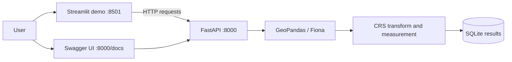

# Geospatial File Measurement API

A Python API for uploading KML and zipped Shapefile data, extracting feature geometry and attributes, and calculating polygon area and line length.

The FastAPI service is the backend and remains the source of all parsing, CRS transformation, and measurement logic. An optional Streamlit app is included as an HTTP client for quick demonstrations; it sends uploads to FastAPI and presents the API's results and map.

## Features

- Accepts `.kml` files and `.zip` archives containing exactly one Shapefile.
- Reads common KML Placemark Point, LineString, Polygon, and MultiGeometry content plus name/description/ExtendedData attributes.
- Extracts a generated feature ID, geometry type and GeoJSON geometry, source CRS, and attributes for each feature.
- Calculates Polygon/MultiPolygon area in square metres and LineString/MultiLineString length in metres.
- Leaves Point and unsupported geometry measurements empty with a reason instead of failing the entire upload.
- Reprojects data before measuring. It never calculates directly in longitude/latitude degrees.
- Saves processed records in SQLite so they remain available after an API restart.
- Applies upload and archive size limits and rejects unsafe ZIP paths.
- Provides interactive OpenAPI documentation.
- Includes an optional Streamlit client with a WGS84 map, file summary, measurements table, and CSV download.

## Requirements

- Python 3.10+
- A GDAL/Fiona installation with Shapefile support to read Shapefile ZIP files. KML Placemark parsing is handled by the application.

## Run locally

```powershell
python -m venv .venv
.venv\Scripts\Activate.ps1
python -m pip install -r requirements.txt
Copy-Item .env.example .env
uvicorn app.main:app --reload --env-file .env
```

The API is available at `http://127.0.0.1:8000`; interactive docs are at `http://127.0.0.1:8000/docs`. On first startup, the API creates the configured SQLite database.

## Quick demo

Run the API and Streamlit client in separate terminals:

```sh
# Terminal 1: the required backend API
uvicorn app.main:app --reload --env-file .env

# Terminal 2: optional interactive client
streamlit run streamlit_app.py
```

Open `http://localhost:8501` for the upload-and-map demo, or `http://localhost:8000/docs` to upload and inspect the REST endpoints directly in Swagger UI. Streamlit calls the API over HTTP; it does not import or run the geospatial processing code.

## Run with Docker Compose

```sh
docker compose up --build
```

The API listens on port `8000`, and Streamlit listens on port `8501`. Docker Compose mounts a named volume at `/data`, so the SQLite database persists when the container is recreated. `docker compose down -v` removes that data volume.

## API

Uploads use the multipart form field named `file`. The default maximum upload is 50 MiB, the maximum expanded ZIP size is 200 MiB, the ZIP entry limit is 1,000, and the maximum feature count is 100,000. These can be changed with environment variables.

### Upload and process

`POST /api/files/`

```sh
curl -F "file=@survey.kml" http://127.0.0.1:8000/api/files/
```

The upload endpoint accepts only `.kml` and `.zip`. The ZIP must contain exactly one `.shp` and its related components. On success it returns HTTP `201`:

```json
{
  "id": "e7e8a45a507f4d6493b76509ae76ab3f",
  "filename": "survey.kml",
  "feature_count": 2,
  "crs": "EPSG:4326",
  "status": "COMPLETED",
  "warnings": [],
  "size_bytes": 7421,
  "sha256": "...",
  "created_at": "2026-10-07T04:20:00+00:00"
}
```

### List and retrieve files

- `GET /api/files/?limit=20&offset=0` lists processed records. `limit` is 1–100.
- `GET /api/files/{id}/` returns metadata, feature count, source CRS, warnings, size, SHA-256 digest, and creation time.
- `GET /api/files/{id}/features/` returns extracted feature IDs, source geometries/CRS, WGS84 display geometries, geometry types, and attributes.
- `GET /api/files/{id}/measurements/` returns one measurement result per feature.
- `DELETE /api/files/{id}/` removes the processed record and its stored feature/measurement results.
- `GET /health` returns `{"status":"ok"}`.

Measurement response example:

```json
{
  "id": "e7e8a45a507f4d6493b76509ae76ab3f",
  "filename": "survey.kml",
  "crs": "EPSG:4326",
  "feature_count": 2,
  "units": {"area": "m²", "length": "m"},
  "measurements": [
    {"feature_id": 0, "measurement": {"type": "area", "value": 1250.4, "unit": "m²"}, "reason": null},
    {"feature_id": 1, "measurement": {"type": "length", "value": 83.2, "unit": "m"}, "reason": null}
  ],
  "warnings": []
}
```

### Error behavior

- `400`: empty, malformed, or unsafe archive; invalid Shapefile ZIP contents.
- `404`: requested file ID does not exist.
- `413`: upload, expanded archive, or archive entry limit exceeded.
- `415`: unsupported file extension.
- `422`: geospatial file cannot be read or is malformed.
- `500`: unexpected persistence failure; details are logged server-side.

If a file has no CRS or cannot be transformed to a suitable projected CRS, the features are still returned. The response includes a warning, and its measurements are unavailable rather than misleading.

## Architecture and processing flow



- `app/main.py` defines the FastAPI routes, HTTP errors, and API lifecycle.
- `app/geospatial.py` streams uploads to a temporary file, validates/reads the geospatial content, transforms geometries, and builds feature and measurement records.
- `app/database.py` persists processed metadata, features, and measurements in SQLite.
- `app/schemas.py` defines response contracts and constrains returned measurement shapes.
- `app/config.py` reads the database path and resource limits from environment variables.

The original upload is deleted after processing. The extracted feature and measurement results are durable in SQLite. Generated feature IDs are zero-based row indexes in the processed file.

## CRS and measurement decisions

The source CRS and source geometry are preserved in feature responses. The API also returns a WGS84 copy of each geometry for map display. For measurement, the file is transformed to EPSG:4326 and GeoPandas estimates a local UTM projection from its bounds. Geometries are projected before calculating planar area and length; the results are reported in metres and square metres. This is intended for regional data. A dataset spanning distant regions or UTM zones may need a deliberately selected projection or a per-feature strategy.

Polygons and lines, including their multi-geometry forms, are measured. Points, null geometries, and unsupported geometry types remain in the feature output and get a measurement reason. Missing CRS does not trigger an assumed CRS.

## Configuration

Copy `.env.example` and set any values before running:

| Variable | Default | Purpose |
| --- | --- | --- |
| `DATA_DIR` | `./data` | Default directory for application data |
| `DATABASE_PATH` | `./data/geospatial.sqlite3` | SQLite database location; overrides `DATA_DIR` |
| `MAX_UPLOAD_BYTES` | `52428800` | Maximum upload size in bytes |
| `MAX_UNZIPPED_BYTES` | `209715200` | Maximum total expanded ZIP size in bytes |
| `MAX_ZIP_ENTRIES` | `1000` | Maximum number of ZIP entries |
| `MAX_FEATURES` | `100000` | Maximum number of features accepted per upload |

## Design decisions, learning, and future scope

FastAPI was selected from the two allowed frameworks because it provides typed request/response contracts and interactive API docs with little setup. GeoPandas and Fiona handle Shapefile reading; the API parses common KML Placemark geometry types directly so KML support does not depend on GDAL's optional KML driver. GeoPandas handles CRS transformations. SQLite keeps the assignment self-contained while providing durable results across restarts.

This project demonstrates API design, streamed uploads, archive validation, GIS formats, coordinate reference systems, measurement, and persistence. A larger production deployment could add Postgres/PostGIS, object storage for original files, authentication, background jobs for very large datasets, configurable projection policies, quotas, and monitoring.
